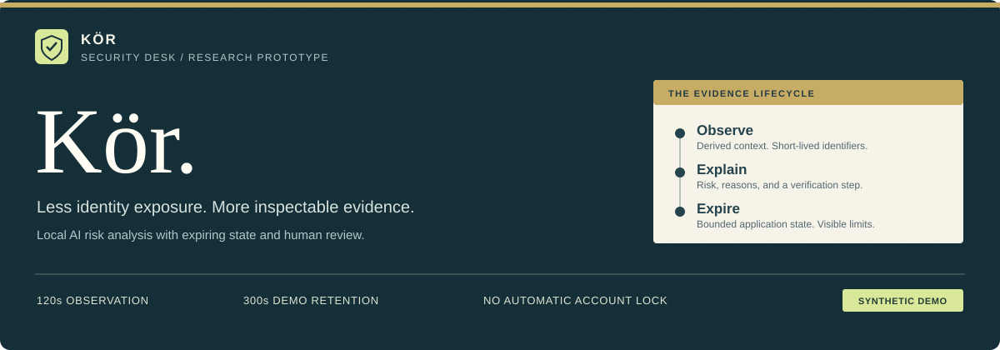
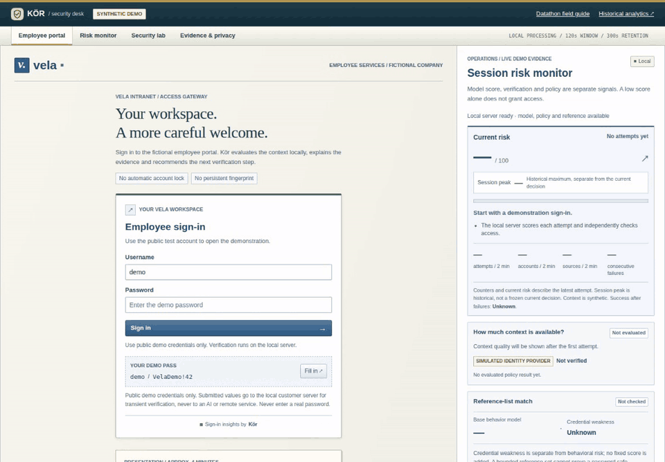
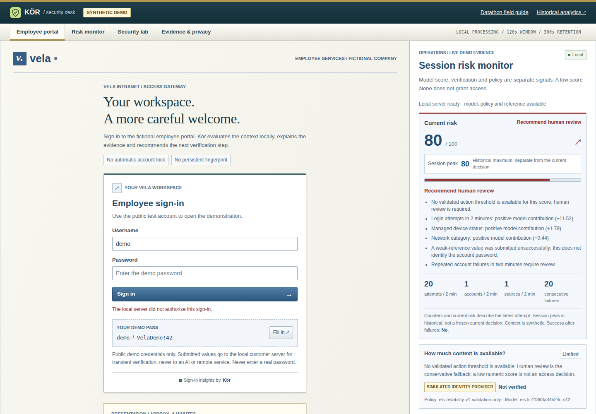
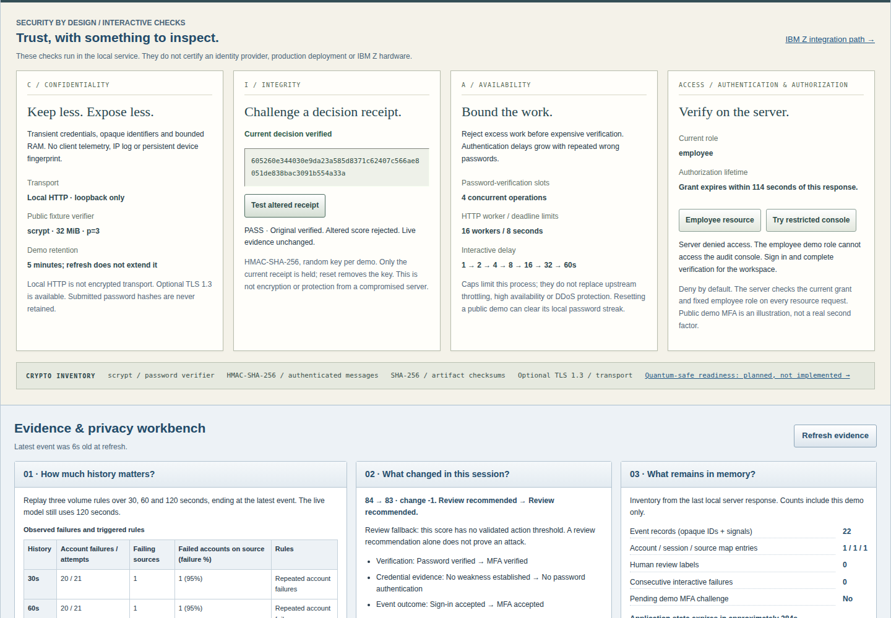
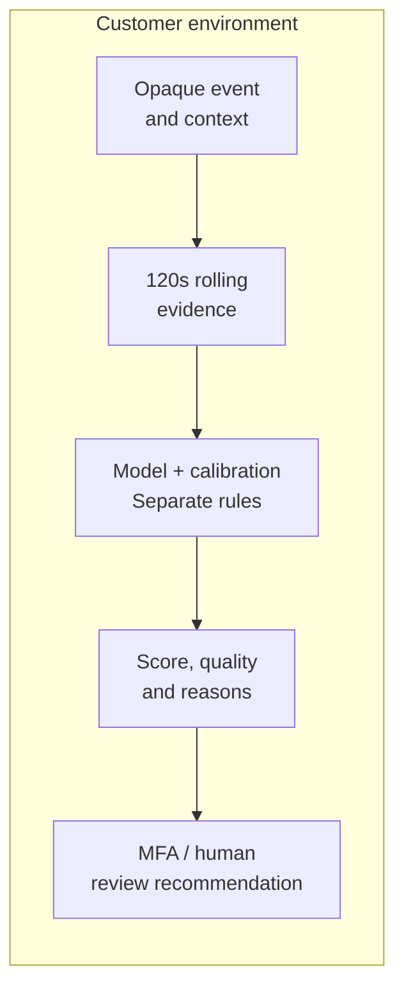

<div align="center">



**Understand suspicious sign-ins. Keep less identity data. Show your evidence.**

[](https://github.com/can-yazicioglu/Kor/actions/workflows/tests.yml)
[](#quick-start)
[](LICENSE)
[](#what-is-actually-validated)

[**Run the demo**](#quick-start) · [**Four-minute pitch**](docs/datathon_demo.md) · [**How it works**](#from-sign-in-to-decision) · [**Türkçe anlatım**](docs/project_story.tr.md)

</div>

Kör is a customer-local **session-risk prototype**. It turns short-lived sign-in evidence into a **0–100 risk score**, readable reasons, and a recommendation for **MFA or human review**. It never automatically locks an account.

The fictional **Vela employee portal** puts the full journey on screen: sign in, replay an attack, inspect the evidence, challenge a decision receipt, and test server-side authorization. Prepared for the **IBM Z Datathon security and privacy theme**; IBM Z execution and quantum-safe integration are future work.

> **Prototype status:** All demonstrations and evaluations use synthetic data. The current model has no validated action thresholds, so even normal complete-context sign-ins receive a review recommendation. The improved experimental model is **blocked from release** after missing a required attack scenario. See [the evidence and limitations](#what-is-actually-validated).

## See it in action

[](docs/media/kor-demo.gif)

*Recorded from the running application using public fictional credentials. Brute force → review → demo MFA → receipt integrity → access control → reset. The score is a model estimate, not a proven attack probability. [Recording details and reproduction](docs/media/README.md).*

<table>
<tr>
<td width="50%"><a href="docs/screenshots/attack-review.png"></a></td>
<td width="50%"><a href="docs/screenshots/security-proof.png"></a></td>
</tr>
<tr>
<td><strong>01 / Follow the risk</strong><br>Current score, retained session peak, reasons and missing context.</td>
<td><strong>02 / Challenge the boundary</strong><br>Verify a receipt and exercise server-owned permissions.</td>
</tr>
</table>

[Desktop portal](docs/screenshots/desktop.png) · [Mobile view](docs/screenshots/mobile.png) · [Demo script](docs/datathon_demo.md)

## Quick start

**Python 3.10+** is enough to run the included demo. No API key, build step, runtime package installation or network access is required after cloning.

```bash
git clone https://github.com/can-yazicioglu/Kor.git
cd Kor
python3 scripts/preflight.py
python3 app/serve.py --port 8001
```

Open **[http://127.0.0.1:8001/company.html](http://127.0.0.1:8001/company.html)**. Keep the terminal running; stop with `Ctrl+C`. On Windows, use `py -3` if `python3` is unavailable. If port 8001 is occupied, choose another `--port` and open that port.

<details>
<summary><strong>Startup troubleshooting: wrong folder or occupied port</strong></summary>

`can't open file .../scripts/preflight.py` means the command was run outside the checkout. Run `cd ~/Kor` first, or use the actual path where you cloned the project.

`Port 8001 is already in use` means another process already owns that port. If your Kör demo is already running there, open its browser address instead of starting it again. Otherwise, choose a free port, for example:

```bash
cd ~/Kor
python3 scripts/preflight.py
python3 app/serve.py --port 8002
```

Then open **http://127.0.0.1:8002/company.html**. The server does not stop the existing process or silently change ports. The preflight's `tuned_candidate: blocked`, `customer_idp: not_connected` and `ibm_z_execution: not_verified` are expected prototype status fields, not a failed startup.

</details>

| Public demo fixture | Value |
|---|---|
| Username | `demo` |
| Password | `VelaDemo!42` |
| Demo MFA code | `123456` |

Use invented values only. The published MFA code illustrates a flow; it is **not a real second factor**. Default transport is loopback HTTP; [optional TLS 1.3 setup](docs/crypto_inventory.md#local-tls-demonstration) is available.

### Your first four-minute demo

1. **Replay an attack.** Click **Brute force** under “Change the story.” Twenty synthetic failures produce evidence and a review recommendation; no remote attack is performed.
2. **Verify the sign-in.** Click **Fill in**, **Sign in**, then enter `123456`. The fictional workspace opens; earlier risk evidence remains visible.
3. **Test integrity.** Open **Security lab** → **Test altered receipt**. The original verifies; a changed score is rejected.
4. **Test authorization.** Open **Employee resource**, then **Try restricted console**. The employee grant works; the restricted request is denied by the server.
5. **Inspect and expire.** Open **Evidence & privacy** to compare rule evidence and retained RAM state. **Reset demo** removes the demo records, grant and current receipt key.

<details>
<summary><strong>More scenarios to try</strong></summary>

- **Password spraying / Distributed attempts:** compare failed-account and failing-source counts within the same two-minute window.
- **VPN / Travel / New device:** inspect benign context changes; they do not automatically prove an attack.
- **Missing history:** the score becomes unavailable, rather than silently becoming zero.
- **Common password / Variation:** see local reference-list evidence, separate from the model score. The live flow adds no arbitrary +25/+10 points.
- **Wrong password:** interactive retries wait **1 → 2 → 4 → 8 → 16 → 32 → 60 seconds**, capped at 60. This per-demo delay clears on reset/expiry; a real provider needs shared account throttling.
- **Suspicious-success example:** a successful sign-in with combined unusual context exercises an explicitly **demo-only** safeguard. It has high benign overlap and is disabled on trusted ingestion.
- **Review feedback:** labels remain short-lived annotations; they neither train the model nor grant access.

</details>

## What is built

| Capability | What you can inspect |
|---|---|
| **AI session risk** | Original 11-feature logistic model, calibrated score, current versus peak risk, explicit missing-context handling. |
| **Attack evidence** | Two-minute brute-force, spraying and distributed-failure rules; sequence evidence stays separate from probability points. |
| **Privacy lifecycle** | Opaque identifiers, bounded RAM, five-minute demo expiry and a count-only retention inventory. |
| **Decision integrity** | One current HMAC-SHA-256 receipt per demo; an altered copy fails verification. |
| **Authentication & authorization** | Salted scrypt fixture verifier, sign-in-bound demo MFA, expiring server-owned employee grants. |
| **Bounded work** | Request deadlines, worker/body/event limits, four password-check slots and exponential retry delays. |
| **Evidence workbench** | Compare 30/60/120-second rule evidence and changes within one account/session without extending retention. |
| **Provider boundary** | Signed, replay-protected events with separate producer/reviewer keys; recommendations only, in shadow mode. |
| **Responsible release** | Frozen synthetic evaluations, attack-specific audit and a loader that refuses the blocked candidate. |

## From sign-in to decision



Credentials are checked transiently by the **demo verifier**, never by the ML model. Model inputs are numeric/context features; identifiers, the target label and attack-type metadata are excluded. The [shared 17-column CSV](docs/synthetic_data.md) remains unchanged. A future provider must derive trustworthy context within the customer environment; no real IdP is connected.

The current score describes the latest scored attempt. The session peak remembers the maximum within retained session evidence. Neither replaces authentication or authorization. Missing context remains unscored, and a successful MFA does not erase earlier evidence. [Architecture](docs/architecture.md) · [Event contract](docs/event_contract.md)

## Privacy with an inspectable boundary

| Data | Current treatment |
|---|---|
| Entered credentials | Transient local verification; fields clear immediately; no raw credential or submitted-password hash log. |
| Raw IPs, persistent fingerprints, mouse/keyboard biometrics | Not collected or retained by this prototype. |
| Opaque tokens, derived events, review labels | Retained temporarily in bounded server RAM; demo lifetime is fixed at five minutes. |
| Receipt key and access grant | RAM only; reset/expiry removes references. The grant lasts at most two minutes. |
| Model, public reference, synthetic training/evaluation files | Versioned development artifacts; intentionally persist in this repository. |

This is **data minimization with explicit retention**, not “zero data storage.” Releasing application references does not prove physical memory erasure. No cookies, browser storage, external analytics or runtime password API are used. Customer-side IdP logs require their own retention policy. [Retention policy](docs/retention_policy.md) · [Threat model](docs/threat_model.md)

The password reference contains **12,526 entries from two pinned password-only dictionaries**, checked locally for exact and bounded near matches. It is not an exhaustive breach search and does not link leaked identities to login events. A failed weak-password attempt says nothing conclusive about the account's real password. [Sources and license](docs/password_sources.md)

## What is actually validated

| Area | Current evidence and boundary |
|---|---|
| **Working software** | 200 Python tests, 16 HTTP/server tests, 111 JavaScript checks and 8 Chromium desktop/mobile cases recorded in the [security review](docs/security_review.md). The CI badge reports the current run. |
| **Default model** | Complete-context scores are available, but no threshold met the predefined false-positive/recall targets. **Review is the current fallback, including normal logins.** |
| **Tuning candidate** | Better synthetic ranking, but **0/108 and 0/115 scored suspicious-success sessions detected** in two final cohorts. **Release blocked; not the default model.** |
| **Demo context safeguard** | Combined new device/network/unusual context triggers an illustrative rule. Its substantial benign VPN/travel overlap is measured; it is **disabled on trusted ingestion**. |
| **Production and IBM Z** | No customer pilot, real IdP, IBM Z hardware execution, Secure Execution attestation or quantum-safe integration has been verified. |

The evaluations use synthetic data from authored generators. They establish reproducibility and reveal failure modes; they do **not** establish real-world accuracy. [Model tuning and release decision](docs/model_tuning.md) · [Rule tradeoffs](docs/datathon_demo.md#tested-experimental-rule-and-its-tradeoff) · [Security review](docs/security_review.md)

### What makes this project distinctive?

Risk-based authentication, MFA, logistic models, scrypt and HMAC are established techniques. The contribution here is their **inspectable, short-lived implementation**: an evidence workbench, visible retention, ephemeral decision receipts and a release process that exposes a failed attack scenario instead of hiding it behind an aggregate metric.

That is an engineering and product contribution, **not a claim of a new ML algorithm, cryptographic primitive or first-of-its-kind system**. [Comparison with existing approaches and originality assessment](docs/originality.md)

## Explore the project

| Start here | Go deeper |
|---|---|
| [Four-minute Datathon pitch](docs/datathon_demo.md) | [Architecture and boundaries](docs/architecture.md) |
| [Project story — Türkçe](docs/project_story.tr.md) | [Cryptographic inventory / TLS setup](docs/crypto_inventory.md) |
| [Company demo walkthrough](docs/company_demo.md) | [Identity-provider integration](docs/runtime_integration.md) |
| [Evidence workbench](docs/evidence_workbench.md) | [Model experiments and blocked release](docs/model_tuning.md) |
| [Originality assessment](docs/originality.md) | [Test plan and security review](docs/test_plan.md) |
| [Development and reproduction](docs/development.md) | [Responsible security reporting](SECURITY.md) |

```text
app/           Vela portal, evidence workbench, local HTTP server
src/runtime/   Ephemeral state, risk policy, verified event ingestion
src/models/    Model evaluation, calibration and release checks
models/        Runtime artifacts and blocked-candidate decision
data/          Synthetic CSVs and public password-reference artifact
experiments/   Frozen tuning protocols, evaluations and source snapshots
tests/         Runtime, privacy, integrity and model regression tests
docs/          Architecture, evidence, demo guides and screenshots
```

For development, see [setup and all test commands](docs/development.md). The original browser-only CSV viewer remains at **http://127.0.0.1:8001/**, explicitly labelled historical; its old password-score experiment is separate from the current login flow.

Contributions should preserve the fixed schema, short retention and honest evaluation boundaries. Start with [CONTRIBUTING.md](CONTRIBUTING.md). Source is [MIT licensed](LICENSE); password-reference attribution is retained under [`third_party/passwords/`](third_party/passwords/).

**Keywords:** privacy-aware AI · cybersecurity · session risk · identity and access management · anomaly detection · adaptive authentication · explainable evidence · responsible AI · data minimization · IBM Z Datathon

Maintainers: [prepared GitHub About and Topics settings](docs/repository_settings.md).
