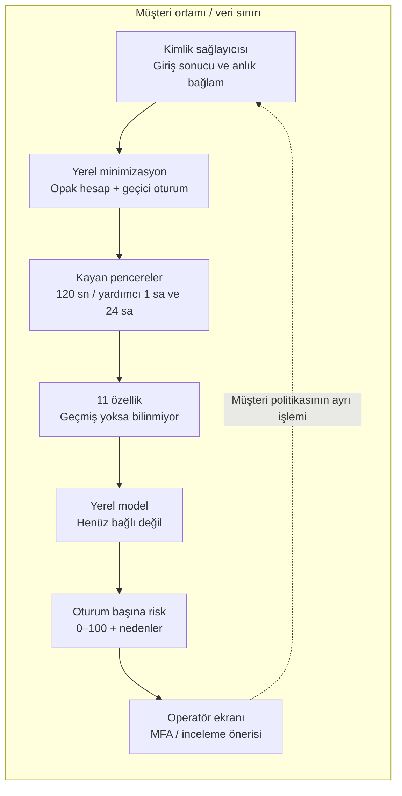

# Mimari — Ephemeral Login Sentinel

Bu belge **hedef ürün mimarisi** ile **AI 1'de gerçekten çalışan demo** arasında ayrım yapar. Özellik çıkarımı, gerçek IdP bağlantısı ve eğitilmiş model henüz uygulanmamıştır. Ortak CSV şeması değişmemiştir.

## 1. Hedef veri akışı ve gizlilik sınırı



Ham parola özellik çıkarımına girmez; kimlik doğrulama sağlayıcısının sınırında kalır. Ham kullanıcı adı, ham IP ve kalıcı cihaz izi model, CSV, uygulama logu veya AI sohbetine aktarılmaz. Gerekli ağ bağlamı müşteri içinde anlık olarak türetilir; IP için ayrı bir kalıcı kayıt oluşturulmaz. Müşterinin mevcut IdP log saklama politikası bu prototipin kontrolünde değildir; hedef entegrasyonda ayrıca gözden geçirilmelidir.

**Dışarı çıkmayanlar:** olaylar, CSV, hesap/oturum anahtarları, özellikler, model istekleri ve sonuçları. Tasarım dış AI API'si gerektirmez. Opaklaştırılmış kayıtlar da hâlâ ilişkilendirilebilir ve hassas kabul edilir.

## 2. Bugün çalışan yol

```text
Python loopback sunucusu → yerel HTML/CSS/JS
                                   ↓
               Sabit mock görünüm VEYA kullanıcı seçimiyle CSV
                                   ↓
             UTF-8 + tam şema + tip/sınır doğrulama
                                   ↓
              Özellik allowlist'i → predictRisk(features)
                                   ↓
           Model yok: null → “Puan bekleniyor” → karar yok
```

`app/serve.py` yalnızca `127.0.0.1` üzerinde statik dosyalar sunar. Dosya listesi sabittir; depo, belgeler, model, test ve veri dizinleri sunulmaz. CSV yükleme endpoint'i yoktur. Tarayıcı File API ile CSV'yi bellekte okur. `localStorage`, `sessionStorage`, IndexedDB, service worker, cookie, analitik veya konsol veri logu kullanılmaz.

Sunucu erişim logu yazmaz. `Cache-Control: no-store`, `Referrer-Policy: no-referrer`, MIME koruması ve bir içerik güvenlik politikası uygular. `connect-src 'none'` ağ API çağrılarını engeller; üçüncü taraf script/font/görsel yoktur. Host başlığı loopback adresleriyle sınırlıdır. Bu önlemler üretim yetkilendirmesi veya izole bir işletim sistemi yerine geçmez.

“Mock görünüm” bellekteki içe aktarım referanslarını bırakır ve sabit kartları geri getirir. Yeni başarılı içe aktarım önceki CSV'nin yerini alır. Hatalı CSV önceki görünümü korur. Sayfa yenileme/kapanışı veriyi uygulama açısından bırakır; JavaScript çöp toplama, tarayıcı veya işletim sistemi için garantili fiziksel bellek silme iddiası yoktur. Seçilen kaynak dosya kullanıcının diskinde kalır.

## 3. Kimlikler, pencere ve özellik anlamları

### Kimlik yaşam döngüsü

- `event_id`: yinelenen olayları ayıran opak anahtar; benzersiz olması gerekir. Yalnızca gruplama/izlenebilirlik.
- `session_token`: kriptografik güvenli rastgele üretilecek kısa ömürlü anahtar. Hedef cookie politikası için başlangıç önerisi: 15 dakika mutlak ömür, `Secure`, `HttpOnly`, `SameSite=Lax`, kimlik doğrulamada döndürme. Bu parametreler demo uygulaması değil, müşteri entegrasyonu tasarımıdır. TTL, iki dakikalık analiz penceresinden farklıdır. Token yenileme davranışı saldırı korelasyonunu etkileyebilir.
- `account_token`: gerekiyorsa müşteri IdP'sinin opak kimliği; alternatif olarak yalnızca müşteri sunucusunda gizli anahtarla türetilen, kiracıya özgü takma kimlik. Düz kullanıcı adı hash'i kullanılmaz. Ham ad mapping'i ve gizli anahtar modelde veya CSV'de bulunmaz. Hesap gruplaması gerekmiyorsa alan boş kalabilir. Brute force özelliklerinin üretilebilmesi için özellik çıkarımı sırasında hesap ilişkilendirmesi gerekir.

Rastgele oturum cookie'si bir cihaz kimliği değildir. Cookie yenilendi diye `device_new=1` üretilemez. Yeni/yönetilen cihaz sinyali müşteri IdP'sinin mevcut güvenilir bağlamından, kalıcı bir parmak izi oluşturmadan alınabilmelidir. Bu bilgi yoksa alan bilinmiyor kalır.

### Zaman ve sayaçlar

Önerilen ortak anlam: UTC olay zamanı `t` için pencere **(t−120 saniye, t]**; olayın kendisi bir kez dâhil edilir. `attempts_2m` ve `attempts_1h` aynı hesap kapsamındadır. Olay zamanı esas alınır; üretim tüketicisi yinelenen/geç gelen olay politikası belirlemelidir. Model özelliklerine gelecekteki olaylar katılmaz. Demo sayaç üretmez ve verilen sayaçların doğruluğunu kanıtlamaz.

`distinct_accounts_2m` hesap veya cookie bazında değil, **aynı müşteri içindeki ortak kaynak bağlamı** bazında hesaplanmalıdır. Ortak CSV kaynak anahtarı içermez. Özellik çıkarıcı, gerekli kaynak eşlemesini müşteri içinde geçici bellekte yapmalı; iki dakikalık pencere ve kabul edilen gecikme sonunda silmelidir. Salt per-session sayım cookie yenileyen bir saldırganı kaçırır. Ham IP veya ağ kimliği modele gönderilmez. NAT ortak kullanıcıları bir araya getirebilir; dağıtık saldırılar kaynak gruplamasını aşabilir. Bu nedenle özellik tek başına saldırı kararı değildir.

`failed_ratio_24h`, IdP'deki geçmiş sonuçlardan türetilir; `is_suspicious` etiketi başarısız giriş demek değildir. `geo_velocity_kmh` için gerekiyorsa müşteri içinde kaba konum ve zaman farkından hız hesaplanır; ham IP ve hassas konum CSV'ye eklenmez. Önceki gözlem yoksa hız sıfır varsayılmaz. VPN, seyahat ve ağ konumu belirsizliği bu özelliğin güvenilirliğini sınırlar.

30 günlük gerçek geçmiş varsayılmaz. Zaman alışkanlığı ve ağ aşinalığı mevcut, yeterli ve izin verilen geçmişten üretilebiliyorsa kullanılır. Aksi hâlde boş değer korunur. 1 saat/24 saat sayaçlarının bulunması 30 günlük profilin mevcut olduğunu göstermez.

## 4. Sabit CSV sözleşmesi

```csv
event_id,event_ts_utc,session_token,account_token,attempts_2m,attempts_1h,distinct_accounts_2m,failed_ratio_24h,hour_deviation,typical_weekday,geo_velocity_kmh,network_familiarity,asn_category,device_managed,device_new,is_suspicious,attack_type
```

Başlıklar tam ve bu sırada olmalıdır. UTF-8, isteğe bağlı BOM, virgül ayırıcı, LF/CRLF ve CSV tırnak kaçışları desteklenir. Boyut sınırı 2 MiB, olay sınırı 10.000'dir. Ek/eksik/sırası değiştirilmiş sütunlar reddedilir. Hatalar hücre içeriğini veya dosya adını yansıtmaz.

Brief alan tiplerini ve kategori sözlüğünü tamamen belirtmez. Aşağıdaki kodlamalar **AI 1'in geçici okuyucu sözleşmesidir**, ortak şema değişikliği veya ekip tarafından onaylanmış özellik tanımı değildir. AI 2 teslimiyle uyum sağlama notları [ayrı rapordadır](integration_notes_ai1.md).

| Alan | Demo okuyucusunun kabulü | Kullanım |
| --- | --- | --- |
| `event_id` | Boş olmayan, boşluksuz, en fazla 128 karakter; tekil | Kimlik; modele girmez |
| `event_ts_utc` | UTC `YYYY-MM-DDTHH:mm:ss[.SSS]Z`; geçerli takvim zamanı | Sıralama; modele girmez |
| `session_token` | Boş olmayan, boşluksuz, en fazla 128 karakter | Oturum gruplaması; modele girmez |
| `account_token` | Opak metin, en fazla 128 karakter; boş olabilir | Hesap bağlamı; modele girmez |
| `attempts_2m` | Negatif olmayan güvenli tamsayı veya boş | Özellik; 120 saniye |
| `attempts_1h` | Negatif olmayan güvenli tamsayı veya boş | Özellik; 1 saat |
| `distinct_accounts_2m` | Negatif olmayan güvenli tamsayı veya boş | Özellik; kaynak bağlamında farklı hesap |
| `failed_ratio_24h` | 0–1 veya boş | Özellik; 24 saat |
| `hour_deviation` | Negatif olmayan sayı veya boş | Özellik; saat sapması, çevrimsel anlam netleştirilecek |
| `typical_weekday` | `0/1`, `false/true` veya boş | Özellik; 1 olağan gün varsayımı |
| `geo_velocity_kmh` | Negatif olmayan sayı veya boş | Özellik; km/sa |
| `network_familiarity` | 0–1 veya boş | Özellik; 1 tanıdık varsayımı |
| `asn_category` | En fazla 64 karakterlik kategori veya boş | Özellik; sözlük henüz sabitlenmedi |
| `device_managed` | `0/1`, `false/true` veya boş | Özellik |
| `device_new` | `0/1`, `false/true` veya boş | Özellik |
| `is_suspicious` | `0/1`, `false/true` veya boş | Yalnızca hedef etiket |
| `attack_type` | En fazla 64 karakterlik kategori veya boş | Yalnızca değerlendirme metaverisi |

Boş özellik `null` olarak korunur. Eksik etiketli olay görüntülenebilir; bu, AI 3'ün etiketsiz veriyle denetimli eğitim yapabileceği anlamına gelmez. `account_token`ın opaklığı ve dosyanın sentetik oluşu biçim kontrolünden ispatlanamaz; uygun veri hazırlama sorumluluğu veri sahibindedir. Aynı şekilde sayaçların geçmişten doğru türetildiği bu demo tarafından doğrulanmaz.

## 5. Model entegrasyonu ve etiket sızıntısının önlenmesi

`app/schema.js` içindeki `selectFeatures()` yalnızca aşağıdaki anahtarları çıkarır:

```text
attempts_2m, attempts_1h, distinct_accounts_2m, failed_ratio_24h,
hour_deviation, typical_weekday, geo_velocity_kmh,
network_familiarity, asn_category, device_managed, device_new
```

`event_id`, `session_token`, `account_token`, `event_ts_utc`, `is_suspicious` ve `attack_type` çağrıya taşınmaz. Ham zaman yerine zaten türetilmiş zaman özellikleri kullanılır. `attack_type` gerçek CSV görünümünde tahmin edilmiş saldırı adı gibi gösterilmez; `is_suspicious` puana çevrilmez.

AI 3'ün bağlanacağı sınır `app/model-adapter.js` içindeki `predictRisk(features)` fonksiyonudur. Bugün daima `null` döner. Gelecekte müşteri içinde çalışan uygulama şu sonucu üretir:

```ts
type Prediction = null | {
  risk_score: number;    // Sonlu tamsayı, 0–100; 100 en yüksek risk.
  reasons: string[];    // En fazla 6 gerekçe; her biri 1–240 karakter.
  model_version: string; // Boş olmayan, en fazla 80 karakter.
};
```

Gerekçeler yalnızca modele verilen özelliklerden ve modelin belgelenmiş açıklama yönteminden gelmelidir; etiket, saldırı metaverisi, kullanıcı adı veya başka ham veri içeremez. Gerekçe yoksa arayüz bunu açıkça belirtir. Model versiyonu veri kaydı içermez. UI, tüm değişken metni `textContent` ile işler; HTML çalıştırmaz. Belirtilen nedenler özellik katkısı yöntemi uygulanmadıkça SHAP veya nedensel açıklama gibi adlandırılmaz.

Model belirsiz/missing girdiyi işleyemiyorsa null döndürmelidir; sıfırla doldurma otomatik değildir. İleride yerel HTTP servisi seçilirse yalnızca müşteri ortamındaki uç nokta için CSP, erişim kontrolü, timeout ve veri saklama politikası birlikte uygulanmalıdır. Mevcut demo ağ çağrılarını özellikle kapalı tutar; bir dış servis URL'si eklemek bu mimariye uygun entegrasyon sayılmaz.

### Oturum puanlaması

1. Olaylar `session_token` ile gruplanır; model her olayın sadece özelliklerini alır.
2. **Tüm olaylar puanlandıysa**, en yüksek olay puanı oturum riski olur. Eşitlikte en son olay seçilir. Risk gerekçeleri ve sinyal çipleri aynı seçilmiş olaya aittir.
3. Herhangi bir olayda model yoksa, hata varsa veya sonuç sözleşme dışıysa oturum puanı gösterilmez. Tam değerlendirilmemiş oturum düşük risk diye sunulmaz. Hata UI'da ayırt edilir.
4. Oturumlar en son olay zamanına göre sıralanır. Bu özet, yalnızca yüklenen dosyanın kapsamıdır; oturumun tüm yaşamını veya canlı akışı temsil etmez.

En yüksek olay puanı bir MVP **entegrasyon kararıdır**; doğrulanmış bir oturum modeli değildir. AI 3 farklı toplulaştırma önerirse ayrı incelemeyle değiştirilmelidir. Çok olaylı oturumların riski bu yöntemle daha yüksek görünebilir.

## 6. Aksiyon politikası

| Risk | Ekran önerisi |
| --- | --- |
| Bilinmiyor / model hatası | Puan bekleniyor; karar üretilmez |
| 0–29 | İzlemeye devam et |
| 30–69 | MFA öner |
| 70–100 | MFA + insan incelemesi öner |

Bu eşikler **demo varsayımıdır**; gerçek dünyada kalibre edilmiş eşikler değildir. Puan “% saldırı ihtimali” olarak sunulmaz. Ürün bir hesabı kilitlemez; demo IdP'ye komut göndermez veya gerçek MFA tetiklemez. Üretim entegrasyonunda müşteri güvenlik politikası ve yetkili operatör aksiyonu ayrı bir katmandır.

## 7. Geçmiş, saklama ve üretim sınırlamaları

Hedef özellik servisi iki dakikalık kaynak korelasyonunu pencere ve kabul edilen geç kalma süresi sonunda siler. 1 saat/24 saat yardımcı özetler için ayrı ve sınırlı süreli müşteri içi sayaçlar gerekir; bunlar ham olayların sınırsız saklanmasını gerektirmez. Hesap/ağ alışkanlığı geçmişinin kapsamı, saklama süresi ve yeterlilik ölçütü henüz kararlaştırılmamıştır. 30 günlük profil varmış gibi doldurulamaz.

Demo bir loopback geliştirme sunucusudur. Üretim için tenant izolasyonu, yetkilendirme, TLS, anahtar yönetimi, denetim kaydı minimizasyonu, gecikme politikası, saldırgan kontrollü girdilere dayanıklılık, MFA yorgunluğu ve eşik kalibrasyonu ayrıca ele alınmalıdır. Demo bu özellikleri uygulamış gibi sunulmaz.

Sentetik veriyle elde edilebilecek metrikler gerçek saldırgan davranışı veya gerçek müşteri başarısını kanıtlamaz. AI 1'in arayüz sayaçları da sınıflandırma metriği değildir. Şüpheli başarılı giriş, kaynak korelasyonu, NAT/VPN ve cihaz bağlamı sınırlamaları ayrıca [entegrasyon notunda](integration_notes_ai1.md) izlenir.
