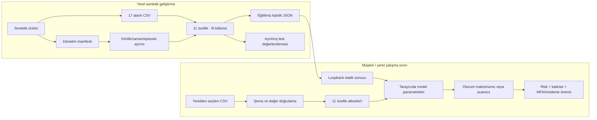

# Ephemeral Login Sentinel — uygulanan mimari

Bu belge yerel MVP'yi açıklar. Model artık bağlıdır; canlı IdP/özellik toplama servisi uygulanmış gibi sunulmaz. Sabit CSV şeması değişmemiştir.

## Veri akışı



CSV sunucuya gönderilmez. Modelin çıkarımı tarayıcıda JavaScript ile yapılır. Harici AI API'si, analitik, veri yükleme endpoint'i veya gerçek IdP komutu bulunmaz.

## Bileşenler

| Bileşen | Sorumluluk |
| --- | --- |
| `src/data/generate_synthetic.py` | Sentetik akış, nedensel sayaçlar, sabit CSV ve ayrı denetim manifesti |
| `src/models/core.py` | 11 özellik listesi, veri/manifest doğrulama, bölme denetimi, portable çıkarım ve eşik seçimi |
| `src/models/train.py` | Fit üzerinde eğitim ve model export; CSV/manifest doğrulanmadan çalışmaz |
| `src/models/evaluate.py` | Yeniden eğitim yapmadan test/alt grup/oturum/politika değerlendirmesi |
| `models/demo_model.json` | Gerçek eğitimden katsayı, ölçekleme, kategori sözlüğü, sürüm ve veri hash'i |
| `app/schema.js` | CSV ayrıştırma, tip/sınır denetimi ve model girdi allowlist'i |
| `app/model-adapter.js` | Model sözleşmesi doğrulama ve yerel lojistik çıkarım |
| `app/sessions.js` | Oturum gruplaması, tam puanlama şartı, maksimum puan ve aynı olaya ait gerekçeler |
| `app/lifecycle.js` | Mutlak süre sonu ve uygulama referanslarının bırakılması |
| `app/serve.py` | Yalnızca izinli web dosyaları ve doğrulanmış model JSON'u için loopback HTTP |

## Sabit veri sözleşmesi

```csv
event_id,event_ts_utc,session_token,account_token,attempts_2m,attempts_1h,distinct_accounts_2m,failed_ratio_24h,hour_deviation,typical_weekday,geo_velocity_kmh,network_familiarity,asn_category,device_managed,device_new,is_suspicious,attack_type
```

CSV UTF-8 ve virgülle ayrılır; BOM, tırnak kaçışları ve LF/CRLF desteklenir. Başlık/sıra tam eşleşmeli. UI sınırı 2 MiB ve 10.000 olaydır. Yinelenen olay, geçersiz UTC/tip, saat sapması sınırı ve alt-pencere sayacı tutarsızlığı reddedilir. Hatalar değer, token veya dosya adını yansıtmaz.

| Alanlar | Anlam / kodlama |
| --- | --- |
| `event_id`, `session_token`, `account_token` | Opak kimlik/gruplama; model girdisi değil. Hesap token'ı gerekmiyorsa boş olabilir. |
| `event_ts_utc` | Geçerli ISO 8601 UTC `Z`; sıralama ve bölme denetimi, model girdisi değil |
| `attempts_2m`, `attempts_1h` | Aynı hesapta `(t−120s,t]` ve `(t−3600s,t]` denemeleri; mevcut olay dâhil |
| `distinct_accounts_2m` | Aynı geçici kaynakta 120 saniyedeki farklı hesaplar; kaynak anahtarı modele/CSV'ye girmez |
| `failed_ratio_24h` | Önceden bilinen son 24 saatlik sonuçlarda başarısızlık oranı 0–1; mevcut olayın sonucu hariç |
| `hour_deviation` | Sentetik/izinli geçmişteki olağan saate çevrimsel uzaklık, 0–12 saat |
| `typical_weekday`, `device_managed`, `device_new` | Boolean 0/1; okuyucu true/false'u da normalleştirir |
| `geo_velocity_kmh` | Negatif olmayan hız bağlamı; sentetik üretimde koordinat kullanılmaz |
| `network_familiarity` | `familiar` veya `unfamiliar` kategorisi |
| `asn_category` | `residential`, `business`, `cloud`, `vpn`, `unknown` kategorileri |
| `is_suspicious` | Yalnız hedef etiket |
| `attack_type` | Yalnız değerlendirme senaryosu; model tahmini veya giriş sonucu değil |

Boş özellik `null` kalır. İçe aktarım tanınmayan kısa kategori metnini güvenli metin olarak koruyabilir; model bilinmeyen kategoride puan üretmez. Model çıkarımı mevcut olay dâhil sayaçları en az 1 kabul eder; 0 gibi desteklenmeyen değerler düşük risk sayılmaz. Kullanıcı adı/IP'nin opak alana yanlışlıkla konmadığı yalnız biçim kontrolünden ispatlanamaz.

CSV'nin dışında, yalnız sentetik denetim için SHA-256 bağlı bir manifest vardır. Olayın split/episode/geçici kaynak/başarı bilgisi, önceki sentetik sonuçlar ve profil kökeni buradadır. Model bu alanları kullanmaz. Başarı ve spraying gruplaması bu manifest ile sentetik ortamda doğrulanabilir; gerçek müşteri ortamında IdP ve yerel kaynak korelasyonu gereklidir.

## Pencere ve geçmiş

Özellikler olay zamanına göre sıralı akıştan hesaplanır; aynı timestamp'teki önceki kayıtlar ingestion sırasıyla bilinir, sonraki kayıt görünmez. 24 saat oranı güncel olay sonucu eklenmeden hesaplanır. `attempts_2m <= attempts_1h` zorunludur. Cookie dönüşümleri hesap/kaynak sayacını sıfırlamaz.

30 günlük profil sentetik parametre olarak simüle edilir; gerçek 30 günlük olay geçmişi iddiası yoktur. Gerçek ortamda geçmiş yoksa doldurulmaz. `device_new` cookie yenilendi diye üretilmez; müşteri IdP'sinin güvenilir cihaz bağlamından gelmelidir. VPN konum sıçraması fiziksel seyahat veya saldırı kanıtı değildir.

Sentetik fit/validation/test dönemleri ve hesapları üretimde ayrılır. Bölmeler arasında hesap, oturum, episode ve kaynak kesişimi yasaktır; en az 120 saniye zaman boşluğu doğrulanır. Bu ayrım aynı üretici şablonlarına özgü kolaylığı ortadan kaldırmaz; gerçek dünya genellemesi ayrıca sınanmalıdır.

## Model sözleşmesi

Modelin izinli girdileri yalnızca 11 CSV özelliğidir: `attempts_2m`, `attempts_1h`, `distinct_accounts_2m`, `failed_ratio_24h`, `hour_deviation`, `typical_weekday`, `geo_velocity_kmh`, `network_familiarity`, `asn_category`, `device_managed`, `device_new`.

Kimlik, ham timestamp, hedef, attack_type veya manifest girdiye eklenmez. Kategoriler önceden tanımlı; sayısal standardizasyon sadece fit bölümünden öğrenilir. Çıkarımda bilinmeyen/eksik özellikler doldurulmaz; herhangi biri desteklenmiyorsa sonuç null'dır. JSON'daki median fit özeti olup çıkarımda imputation için kullanılmaz.

```ts
type Prediction = null | {
  risk_score: number;     // Sonlu tamsayı 0–100.
  reasons: string[];      // En çok 6 kısa gerekçe.
  model_version: string; // Boş olmayan sürüm.
};
```

Demo lojistik katsayılarıyla logit hesaplar, sigmoid sonucunu `floor(p*100+0.5)` ile 0–100 puana dönüştürür. Bu sınıf ağırlıklı skor kalibre saldırı olasılığı değildir. Gerekçeler pozitif özellik katkılarıdır; SHAP veya nedensellik değildir. UI gerekçeleri güvenli metin olarak işler.

Model JSON'u özellik sırası, katsayı boyutları, sonlu sayılar, kategori sözlüğü, eksiklik politikası ve sürüm bakımından doğrulanır. Artefakt checksum'ı kazara bozulmayı yakalar; imza veya kaynağın kimliğini doğrulama mekanizması değildir. Yerel sunucunun model dosyasını sunması CSV'nin sunucuya gönderilmesi anlamına gelmez. Model yok/bozuksa mock ekran kullanılabilir, CSV olaylarına uydurma puan verilmez.

## Oturum ve aksiyon

`session_token` yalnız uygulama gruplamasıdır. Tüm olayları puanlanan oturumda en yüksek olay puanı kullanılır; eşit puanda en son olay seçilir. Risk gerekçeleri/sinyaller aynı seçilmiş olaya aittir. Herhangi bir olay puansızsa oturum puansız kalır; kısmi değerlendirme tamamlanmış gibi gösterilmez. Ekran yalnız yüklenen dosyanın kapsamını temsil eder.

| Puan | Öneri |
| --- | --- |
| Bilinmiyor | Eksik bağlam/model durumunu incele; düşük risk varsayma |
| 0–29 | İzlemeye devam et |
| 30–69 | MFA öner |
| 70–100 | MFA + insan incelemesi öner |

30/70 demo politikası, model karşılaştırması için validation'da seçilen eşikten ayrıdır. Değerlendirme hem benchmark eşiğini hem gerçek arayüz politikasını raporlar. Oturum maksimumunun yanlış alarm davranışı olay metriklerinden farklı olabilir; ayrıca oturum özeti incelenir. Otomatik kilitleme ve gerçek MFA komutu yoktur.

## Gizlilik, yaşam döngüsü ve kapsam

Sunucu yalnız `127.0.0.1` üzerinde çalışır; Host ve dosya allowlist'i vardır. Üçüncü taraf script/font/analitik yoktur. CSP bağlantıları yalnız aynı origin ile sınırlar; POST kabul edilmez. Log, cookie ve kalıcı browser storage oluşturulmaz. CSV bellekte tutulur; 5/10/15 dakika, sıfırlama ve sayfadan ayrılma referansları bırakır. Askı sonrası süre yeniden kontrol edilir. Fiziksel silme garanti edilmez.

Ayrıntılı dosya/sayaç/model yaşam döngüsü [retention_policy.md](retention_policy.md) içindedir. 120 saniyelik analiz penceresi, tarayıcı saklama süresi ve gerçek oturum cookie TTL'si farklıdır. Canlı IdP, üretim erişim kontrolü, çok kiracılı servis, gerçek cookie veya gerçek zamanlı TTL deposu bu statik yerel prototipte yoktur. Üretim kullanımı ve gerçek dünya etkinliği onayı bu teslimin sonucu değildir.
