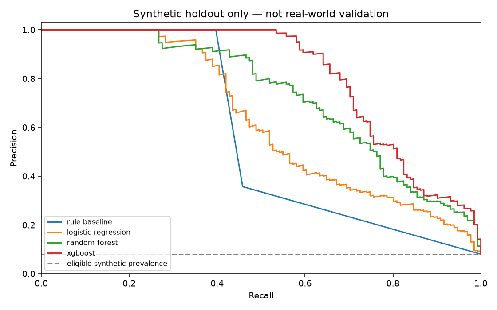

# AI 3 — Modelleme ve sentetik değerlendirme

Bu sonuçlar **yalnızca teslim edilen sentetik üreticinin ayrılmış test bölümüne** aittir. Gerçek müşteri performansı, kalibre saldırı olasılığı veya gerçek dünyada kanıtlanmış başarı değildir. Aynı üreticinin şablonları tüm bölmelerde bulunduğu için şablondan bağımsız genelleme doğrulanmamıştır.

## Tekrar çalıştırma

```bash
.venv/bin/python -m src.models.train
.venv/bin/python -m src.models.evaluate
.venv/bin/python -m unittest discover -s tests -p 'test_models.py' -v
```

İlk komut teslim edilmiş CSV ve SHA-256 eşleşen sentetik manifest yoksa eğitimden önce durur. İkinci komut yeniden eğitim yapmadan yerelde oluşturulmuş modeli değerlendirir. `comparison_models.joblib` yalnızca bu projede üretilmiş güvenilen dosyadır; dışarıdan gelen pickle/joblib yüklemeyin. Tarayıcı yalnızca `models/demo_model.json` kullanır; müşteri CSV'si sunucuya yüklenmez. Model JSON bütünlük özeti Python çıkarımında ve demo sunucusunda doğrulanır; SHA-256 özeti kazara değişikliği yakalar, imza veya kaynak doğrulaması değildir.

CSV SHA-256: `41383a34524cefb434a66608c74a6554bada4377968298c6d7b7a43e4168b625`.

## Özellik ve bölme sınırı

Girdi yalnızca sabit 11 özellik allowlist'idir. `event_id`, `event_ts_utc`, `session_token`, `account_token`, `is_suspicious`, `attack_type` ve tüm manifest metaverisi girdiden dışlanır. Kimlikler yalnızca ayrım denetiminde, etiket yalnızca hedef/değerlendirmede kullanılır. Ölçekleme sadece `fit` üzerinde öğrenilir; kategoriler veri sözleşmesinde önceden sabittir. Eksik geçmişi olan veya desteklenmeyen herhangi bir özelliği olan satır puanlanmaz; 0 risk sayılmaz, imputasyon yapılmaz. JSON'daki median yalnızca fit özeti olarak taşınır ve çıkarımda kullanılmaz.

| Bölme | Tüm satırlar | Puanlanabilir | Çekimser | Hesap | Episode |
|---|---:|---:|---:|---:|---:|
| fit | 6000 | 4899 | 1101 | 342 | 1805 |
| validation | 2000 | 1625 | 375 | 115 | 584 |
| test | 2000 | 1631 | 369 | 116 | 598 |

Bütün bölme çiftlerinde ortak hesap, oturum, episode ve sentetik kaynak sayısı **0**. Zaman sırası ve en az 120 saniyelik boşluk eğitim başlamadan doğrulanır. 30 günlük geçmiş yalnızca sentetik manifestte simüle edilir; gerçek kullanıcı geçmişi varsayılmaz.

## Karşılaştırma ve eşikler

Kural referansı: 2 dakikada ≥8 hesap denemesi ve başarısızlık oranı ≥0,5 → 0,85; 2 dakikada ≥8 farklı hesap → 0,80; yeni cihaz + yabancı ağ + ≥4 saat sapma + ≥600 km/saat → 0,75; aksi → 0,05. Birden çok kuralın maksimumu alınır. VPN veya yeni cihaz tek başına kural alarmı oluşturmaz.

LR: C=1, dengeli sınıf ağırlığı, en çok 2000 iterasyon. RF: 160 ağaç, derinlik 8, yaprak en az 8, dengeli sınıf ağırlığı. Kurulu XGBoost: 150 ağaç, derinlik 3, öğrenme 0,05; sınıf ağırlığı yalnız fit'ten. Seed 42; model/hyperparametreler test sonuçlarına göre seçilmez.

Karar eşiği yalnız validation üzerinde her modelin JSON sonuçlarında kaydedilen `max_fpr` / `min_recall` koşulları altında en yüksek recall (eşitlikte daha düşük FPR) için seçilir. Uygun eşik yoksa `feasible=false`, `threshold=null`; sessiz 50 puan varsayımı yoktur. Bu koşul test kümesinde garanti değildir. PR-AUC burada `average_precision_score` (Average Precision), trapezoid alanı değildir. Eşik metriklerinin paydası yalnız puanlanabilir satırlardır.

| Model | PR-AUC/AP | ROC-AUC | Precision | Recall | FPR | Eşik | TN / FP / FN / TP |
|---|---:|---:|---:|---:|---:|---:|---|
| rule_baseline | 0.4623 | 0.7073 | — | — | — | — | — |
| logistic_regression | 0.6265 | 0.9059 | 0.4457 | 0.5954 | 0.0647 | 0.7812 | 1403 / 97 / 53 / 78 |
| random_forest | 0.7290 | 0.9446 | 0.6040 | 0.6870 | 0.0393 | 0.6772 | 1441 / 59 / 41 / 90 |
| xgboost | 0.8089 | 0.9580 | 0.6012 | 0.7481 | 0.0433 | 0.7371 | 1435 / 65 / 33 / 98 |

Bu çalıştırmanın validation hedefleri: FPR ≤5.00%, recall ≥50.00%.

Kural referansının mevcut 30/70 demo politikaları aynı kararları verir: precision **0.3571**, recall **0.4580**, FPR **0.0720**, TN / FP / FN / TP **1392 / 108 / 71 / 60**. Bunlar önceden tanımlanmış demo politikası metrikleridir; seçilmiş validation eşiği veya uygun eşik bulunamadığında kullanılan sessiz bir varsayılan değildir. Validation kısıtlarının sağlanamaması karşılaştırma tablosunda hâlâ boş eşik/metrik olarak gösterilir.

## Demo modeli ve açıklamalar

**Logistic Regression** tarayıcıda küçük, denetlenebilir bir JSON ile yerel çalışabildiği için demo modeli olarak seçildi. Bu seçim en iyi test metriğine dayanmıyor. 0–100 puan, sınıf ağırlıklı LR sigmoid çıktısının `floor(p*100+0.5)` ile yuvarlanmasıdır; saldırının gerçek olasılığı olarak yorumlanmamalıdır. Üç en büyük pozitif özellik katkısı log-odds cinsinden gerekçedir; SHAP veya nedensellik iddiası yoktur.

UI politikası: 0–29 izleme, 30–69 MFA önerisi, 70–100 MFA + inceleme önerisi; otomatik hesap kilidi yok. Bu ürün politikası validation'da seçilen benchmark eşiğinden ayrıdır. Puanlanamayan olay inceleme gerektirir; düşük risk varsayılmaz. Testte puan ≥30 MFA/inceleme için FPR 0.2607, puan ≥70 inceleme için FPR 0.0967.

Taşınabilir Python çıkarımı ile sklearn arasındaki test maksimum olasılık farkı: `3.33e-16`. `outputs/parity_cases.json` gerçek sentetik CSV'den seçilmiş özellikler ve beklenen sonuçlarla JavaScript eşliğini sınar.

## Oturum düzeyinde demo doğrulaması

Üstteki metrikler **olay** düzeyindedir. Demo oturum puanını puanlanabilir olayların yuvarlanmış puanlarının maksimumu olarak gösterir; herhangi bir olay puanlanamıyorsa tüm oturum puan bekler/inceleme önerir. Aşağıdaki bağımsız denetimde oturum hedefi, yalnız değerlendirme için olay hedeflerinin maksimumudur. Çekimser oturumlar aşağıdaki puan eşiklerinin paydasında yoktur; doğru negatif veya kaçırılan saldırı sayılmaz.

LR test oturumları: 811 toplam, 537 puanlanan, 274 çekimser; 429 birden çok olay içeriyor.

| Oturum politikası | FPR | Recall | TN / FP / FN / TP |
|---|---:|---:|---|
| Puan ≥30 MFA/inceleme | 0.3091 | 0.9091 | 333 / 149 / 5 / 50 |
| Puan ≥70 inceleme | 0.1452 | 0.7273 | 412 / 70 / 15 / 40 |

## Normal zor durumlar ve saldırı alt grupları

Aşağıdaki LR sonuçları validation'da seçilen benchmark eşiğindedir. Desteği olmayan sınıf metriği `—` gösterilir. Çekimser satırlar metrik dışında kalır ve ayrıca sayılır; bunları başarılı tespit veya doğru negatif saymak hatalıdır.

MFA/inceleme FPR sütunları gerçek UI'nın 30/70 puan politikasındaki olay yanlış alarm oranlarını gösterir.

| Alt grup | Toplam | Puanlanan | Çekimser | Benchmark FPR | Recall | ≥30 FPR | ≥70 FPR |
|---|---:|---:|---:|---:|---:|---:|---:|
| brute_force | 64 | 64 | 0 | — | 0.6406 | — | — |
| cold_start | 92 | 0 | 92 | — | — | — | — |
| night_shift | 147 | 127 | 20 | 0.0394 | — | 0.2598 | 0.0551 |
| normal | 791 | 706 | 85 | 0.0283 | — | 0.1827 | 0.0510 |
| password_spraying | 48 | 31 | 17 | — | 0.7097 | — | — |
| suspicious_success | 48 | 36 | 12 | — | 0.4167 | — | — |
| travel_new_device | 203 | 166 | 37 | 0.2289 | — | 0.5060 | 0.2892 |
| user_error | 368 | 331 | 37 | 0.0242 | — | 0.2266 | 0.0453 |
| vpn_new_device | 239 | 170 | 69 | 0.1529 | — | 0.4118 | 0.2294 |
| normal_with_vpn | 536 | 421 | 115 | 0.0736 | — | 0.2613 | 0.1211 |
| normal_new_device | 660 | 489 | 171 | 0.1820 | — | 0.4703 | 0.2495 |
| normal_unfamiliar_network | 651 | 558 | 93 | 0.1398 | — | 0.4283 | 0.1989 |

## Kalan sınırlar ve dosyalar

Özellikle şüpheli başarılı girişin gerçek IdP başarı kaydı CSV'den bağımsız doğrulanamaz; sentetik manifestteki auth_success yalnız test denetimidir. Yakın/sınır saldırılar ve normal VPN/seyahat bağlamları çakışabilir. Yanlış alarmlar ve kaçırılan örnekler var; bu prototip üretim güvenlik kontrolü değildir. Model gerçek müşteri verisiyle doğrulanmamıştır, kalibrasyon ve drift izleme yapılmamıştır.

`outputs/evaluation.json` tüm modellerin destek, çekimserlik, alt grup, confusion matrix ve politika metriklerini içerir. `outputs/holdout_predictions.csv` sadece sentetik event_id korelasyonu ve puan/status taşır; hesap/oturum, timestamp, hedef etiketi ve saldırı metaverisi yazılmaz. `models/comparison_models.joblib` yerel yeniden değerlendirme içindir. `models/demo_model.json` müşteri/olay kayıtları içermeyen taşınabilir parametrelerdir. Bu sentetik geliştirme dosyaları depoda kalabilir; müşteri verisiyle notebook, CSV veya tahmin export'u bu çalışma akışının kapsamı değildir. Manifest/CSV özeti değişirse değerlendirme durur.


