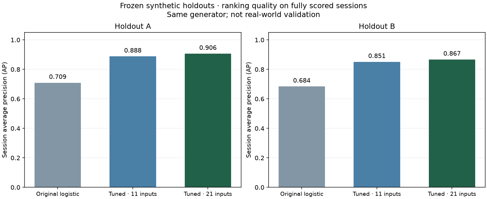

# Model tuning and release decision

This report records the earlier tuning milestone. The subsequent [datathon security extension](datathon_demo.md) adds tested authentication/integrity controls and a demo-only context experiment; it does not change or qualify these frozen candidate results. Current verification totals are in [security review](security_review.md).

**Training and evaluation are complete. The new candidate is not the active demo model.** Two experiments improved ranking and probability error on new synthetic cohorts. A final attack-specific audit found zero detection of the required suspicious-success scenario, so promotion was blocked. The original model, policy and CSV remain unchanged.

## What was implemented

- A reproducible `prepare → fit → evaluate` workflow with a protocol fixed before development, followed by an immutable model/threshold freeze before generating final cohorts.
- Separate cohorts for fitting, two tuning groups, calibration, threshold selection and two final tests. Account, session, source, episode and event identifiers are checked for overlap; phase time ranges are separated by more than two minutes. Earlier inspected cohorts never become new final tests.
- Thirty-six logistic-regression candidates in experiment v1: three feature representations, four regularization values and three class-weight choices.
- Eighteen candidates in experiment v2: two logistic controls and sixteen gradient-boosted tree configurations, with subgroup-aware selection. V1 results motivated v2 and are explicitly consumed development evidence.
- A versioned 21-input candidate: the original eleven context features plus ten measurements of **previous** login attempts in the two-minute window. The shared 17-column CSV is unchanged; additional features are derived in memory from synthetic outcome metadata.
- Standard-library inference for bounded data-only logistic/tree JSON artifacts, integrity validation, sklearn parity checks and exact offline/runtime displayed-score parity.
- A candidate-only recovery rule requiring a new device on an unfamiliar network **and** unusual time/velocity after repeated failures. The default runtime still uses its original rule version.
- Release checks that reject unavailable thresholds, weak evaluation results, changed artifacts and an entirely missed required attack scenario. Explicit candidate selection fails closed; it cannot silently fall back.

The new prior inputs are account attempts, account failures, account failure ratio, failing-source count, source attempts, failed accounts on that source, source failure ratio, median account gap, burst ratio and gap support. Unsupported gap estimates are zero with an explicit support count; an empty known window has zero attempts. Unknown base context still abstains. Current authentication outcome, target/attack labels, passwords and identifier values do not enter the model vector. No real customer data was collected or retention extended.

## Experiment results

V1 contains 74,000 synthetic events, including 24,000 final-test events. It improved average precision but failed false-positive requirements, especially for benign travel and user errors. It was rejected.

V2 contains 94,000 synthetic events, including 32,000 final-test events. The selected candidate is `els-tuned-v2-sequence_log-boosted-d3-l100-r0.1`: 100 trees, maximum depth 3, minimum leaf size 100 and learning rate 0.1. Both selected score thresholds are 90. This equality means score-based escalation goes directly to review; corroborated sequence evidence can independently recommend MFA. The thresholds were fixed before final tests, never adjusted to the table below.

The following metrics are for **fully scored synthetic sessions**, with the actual runtime rules applied. MFA means MFA **or** review. False-positive rate is the fraction of normal scored sessions flagged; recall is the fraction of suspicious scored sessions flagged. Neither is overall accuracy.

| Measure | Final cohort A | Final cohort B |
|---|---:|---:|
| Scored / all sessions | 4,358 / 6,482 | 4,385 / 6,549 |
| Original model session AP | 0.7091 | 0.6839 |
| Tuned 11-input control session AP | 0.8877 | 0.8506 |
| Tuned 21-input candidate session AP | 0.9061 | 0.8667 |
| Original calibrated event Brier error | 0.0459 | 0.0462 |
| Candidate calibrated event Brier error | 0.0275 | 0.0296 |
| Candidate MFA-or-review false-positive rate | 0.20% | 0.35% |
| Candidate MFA-or-review recall | 65.54% | 66.36% |
| Candidate review false-positive rate | 0.08% | 0.03% |
| Candidate review recall | 65.54% | 66.36% |



The aggregate model/runtime gates passed on both final cohorts, including the predeclared benign subgroup limits. Wilson 95% bounds were used for overall FPR/recall checks, with denominators retained in the JSON report. These bounds assume binomial session trials; they do not eliminate residual correlations or common-generator bias. The 21-input model also beat the 11-input tuned control on AP and Brier in both final cohorts. That comparison does not prove each added feature is individually beneficial.

**Coverage remains about 67%.** Missing-context sessions still require review. Including those sessions, roughly **33.4–33.6% of normal sessions** would still receive MFA/review. The 0.20–0.35% numbers above must not be advertised as the total operational false-alarm rate. The old policy's 100% recommendation rate is caused by its unavailable-threshold fallback, not by every old model score being high.

## Why the candidate was not released

An additional descriptive audit of the already-consumed tests separated attack types. This did not retune the model or count as another blind test.

| Required attack scenario | Detected / scored, A | Detected / scored, B |
|---|---:|---:|
| Brute force | 72 / 74 (97.30%) | 64 / 66 (96.97%) |
| Password spraying | 219 / 262 (83.59%) | 226 / 256 (88.28%) |
| Suspicious successful login | **0 / 108 (0%)** | **0 / 115 (0%)** |

This is a material MVP gap. The current generator's suspicious-success episodes contain successful logins without a preceding failed-login sequence; therefore, they do not exercise the separate success-after-failures rule. Their context overlaps benign travel/new-device examples. The aggregate tradeoff does not establish adequate detection of that scenario.

After discovering this, an additional **post-evaluation MVP coverage safeguard** was added. It blocks release when any required scenario has no scored detections or no evaluable examples. This was not a predeclared statistical success criterion and must not be described as one. It only makes release more restrictive; it does not change the frozen scores, thresholds or final metrics.

`final_evaluation.json` preserves the original aggregate-gate result. `attack_breakdown.json` records the uncovered scenario, and `models/tuned_release.json` records the final blocked decision. The earlier aggregate-only qualification receipt is preserved as superseded audit evidence and is rejected by the loader even if copied back. A release must now carry a passed MVP coverage check and the attack-audit digest as well as its model/protocol binding. These local checks detect stale or inconsistent artifacts, not malicious replacement by someone who controls the repository. No user-facing default was switched to the candidate; trusted ingestion never switched. The candidate checkpoint remains available for offline inspection, and `--tuned-demo` refuses to enable this blocked release.

## Use and reproduction

The working demo remains:

```bash
python3 app/serve.py --port 8001
```

Open `http://127.0.0.1:8001/company.html`. The existing synthetic credentials/MFA, backoff and evidence workbench are unchanged. The baseline's unavailable-threshold review fallback remains an explicit unresolved limitation.

Frozen evidence is under [experiment v1](../experiments/tuning_v1/README.md) and [experiment v2](../experiments/tuning_v2/README.md). Both contain fixed-schema compressed CSVs, audit manifests, model artifacts, development/final reports and source snapshots. None contains real customer events. V2 includes an audit against identifiers from all earlier cohorts.

To reproduce the known v2 experiment in a **new output directory**:

```bash
.venv/bin/python -m src.models.tune_followup prepare --run-dir /tmp/kor-tuning-reproduction
.venv/bin/python -m src.models.tune_followup fit --run-dir /tmp/kor-tuning-reproduction
.venv/bin/python -m src.models.tune_followup evaluate --run-dir /tmp/kor-tuning-reproduction
.venv/bin/python -m src.models.audit_tuned --run-dir /tmp/kor-tuning-reproduction
```

Existing run directories cannot be overwritten, and an experiment cannot consume its final cohorts twice. Repeating these known seeds is **reproduction**, not new validation. V1 source snapshots preserve its earlier implementation; current-source hashes intentionally prevent silently re-evaluating it as though the implementation had stayed fixed. No automatic training occurs from demo feedback or five-minute RAM records.

Verification: 186 Python discovery tests, 13 static/HTTP server tests and 100 JavaScript checks passed. Coverage includes real local HTTP flows, causal feature checks, JSON/sklearn parity, candidate startup rejection, stale-receipt rejection and preserved baseline hashes. These are software checks, not empirical detection accuracy. The comparison figure was visually inspected; no browser layout review was available.

## Remaining work supported by the findings

A future study needs predeclared per-attack recall targets in addition to aggregate limits, independently designed suspicious-success cases, trustworthy customer-local context and a plan for missing history. More draws from the same generator cannot establish customer performance. Provider selection, validated event context and a properly governed local pilot remain prerequisites for real deployment. No real records should be uploaded to AI, and any different retention policy requires an explicit project decision.

Implementation guidance: [scikit-learn model selection](https://scikit-learn.org/stable/modules/grid_search.html), [grouped evaluation and preprocessing boundaries](https://scikit-learn.org/stable/modules/cross_validation.html#cross-validation-iterators-for-grouped-data), and [probability calibration](https://scikit-learn.org/stable/modules/calibration.html).
